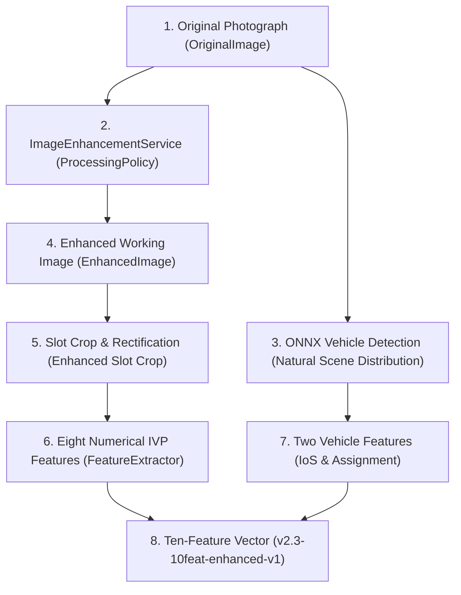

# ParkNChill Canonical IVP Enhancement Policy

**Policy Identifier:** `ivp-enhance-v1`  
**Schema Identifier:** `v2.3-10feat-enhanced-v1`  
**Canonical Implementation:** `com.parknchillai.imageprocessing.ProcessingPolicy`

---

## 1. Executive Summary & Purpose

The ParkNChill v2.3 Image & Video Processing (IVP) pipeline enforces a single canonical enhancement policy across all system stages:
1. Ground truth dataset import (PKLot dataset importer)
2. Interactive slot review and human label creation
3. Live camera and image occupancy inference
4. Pipeline inspector and multi-stage IVP diagnostic preview

Prior to this version, an architectural inconsistency existed where an enhanced preview image was presented to users, but numerical IVP features were calculated from unenhanced raw pixels. This policy guarantees **what is displayed is what is computed**: the exact pixel buffer shown as "Enhanced" is the source of all eight classical IVP features.

---

## 2. Mathematical Definition & Parameters

The canonical policy `ivp-enhance-v1` is defined by the following fixed parameters:

| Parameter | Value | Description |
|---|---|---|
| `policyId` | `"ivp-enhance-v1"` | Unique immutable policy version tag |
| `lowPercentile` | `0.02` (2%) | Lower luminance cumulative histogram cutoff |
| `highPercentile` | `0.98` (98%) | Upper luminance cumulative histogram cutoff |
| `minContrastRange` | `24` | Minimum dynamic range `(high - low)` required to apply contrast stretch |
| `darkMeanCutoff` | `82.0` | Global mean luminance below which dark scene boost is triggered |
| `darkGamma` | `0.86` | Power-law exponent applied to dark scenes ($\gamma < 1.0$ brightens midtones) |
| `brightMeanCutoff` | `190.0` | Global mean luminance above which bright scene attenuation is triggered |
| `brightGamma` | `1.08` | Power-law exponent applied to overexposed scenes ($\gamma > 1.0$ compresses highlights) |
| `neutralGamma` | `1.00` | Exponent for balanced scenes (no non-linear tone adjustment) |
| `lumaR` | `0.2126` | BT.709 red channel luminance weight |
| `lumaG` | `0.7152` | BT.709 green channel luminance weight |
| `lumaB` | `0.0722` | BT.709 blue channel luminance weight |
| `colorSpace` | `"sRGB->BT.709_Luma+HSV_Saturation"` | Colorimetric coordinate transforms |
| `cropInterpolation`| `"BILINEAR"` | Spatial rectification sampling |

### 2.1 Enhancement Algorithm (Step-by-Step)
Given an RGB image $I(x, y)$ of width $W$ and height $H$:
1. **Luminance Calculation:** For each pixel $(x, y)$, calculate scalar luminance:
   $$L(x, y) = \text{round}\left(0.2126 \cdot R + 0.7152 \cdot G + 0.0722 \cdot B\right) \in [0, 255]$$
2. **Histogram & Mean Accumulation:** Accumulate 256-bin histogram $H[l]$ and total luminance sum.
   $$\mu = \frac{1}{W \times H} \sum_{x,y} L(x, y)$$
3. **Percentile Cutoffs:**
   Determine $low = \min \{ l \mid \sum_{i=0}^l H[i] > \lfloor (W \times H - 1) \times 0.02 \rfloor \}$  
   Determine $high = \min \{ l \mid \sum_{i=0}^l H[i] > \lfloor (W \times H - 1) \times 0.98 \rfloor \}$
4. **Contrast Stretch Condition:**
   If $(high - low) \ge 24$:
   $$L_{\text{stretched}}(x, y) = \text{clamp}\left(\frac{L(x, y) - low}{high - low} \times 255.0, 0, 255\right)$$
   Otherwise, $L_{\text{stretched}}(x, y) = L(x, y)$.
5. **Gamma Correction:**
   $$\gamma = \begin{cases} 0.86 & \text{if } \mu < 82.0 \\ 1.08 & \text{if } \mu > 190.0 \\ 1.00 & \text{otherwise} \end{cases}$$
   $$L_{\text{target}}(x, y) = \text{clamp}\left(255.0 \times \left(\frac{L_{\text{stretched}}(x, y)}{255.0}\right)^\gamma, 0, 255\right)$$
6. **Ratio-Preserving RGB Reconstruction:**
   To prevent hue and saturation shifts, channels are scaled proportionally:
   If $L(x, y) \le 1$:
   $$R' = G' = B' = \text{round}(L_{\text{target}}(x, y))$$
   Else, with ratio $r = \frac{L_{\text{target}}(x, y)}{L(x, y)}$:
   $$R' = \text{clamp8}(R \times r), \quad G' = \text{clamp8}(G \times r), \quad B' = \text{clamp8}(B \times r)$$

---

## 3. Pipeline Order & Rationale

The system strictly executes processing in this canonical order:

### Why "Enhance Full Image, Then Crop"?
1. **Global Context vs. Local Fluctuation:** Global contrast percentile computation on the whole parking facility accurately gauges actual ambient lighting conditions (bright sunlight, overcast sky, twilight, asphalt texture). Per-slot crops can be dominated by a single car hood or a tiny white line, which would distort local percentiles and cause erratic tone shifts between adjacent spaces.
2. **Computational Efficiency:** Enhancing the full image once takes approximately $15\text{ ms}$ for a 1080p frame. Cropping from the pre-enhanced image is an $O(1)$ memory slice per slot. In contrast, enhancing each of 100 individual slot crops takes $100 \times 1\text{ ms} = 100\text{ ms}$.
3. **ONNX Detector Separation:** The YOLO/MobileNet vehicle detector model was trained on natural RGB photographs. Altering input contrast or gamma prior to detector inference degrades detection recall. Therefore, vehicle detection runs strictly on `OriginalImage`, while parking slot texture features are extracted from `EnhancedImage`.

---

## 4. Rejection of Double Enhancement

To guarantee mathematical determinism, `ImageEnhancementService` enforces type distinction:
- Input: `OriginalImage`
- Output: `EnhancedImage` (tagged with `policyId` and `fingerprint`)
- Passing an `EnhancedImage` into `enhance()` throws an immediate `IllegalStateException`.
